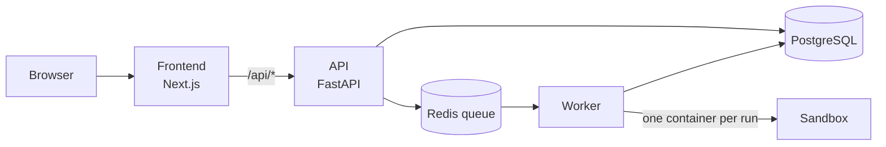

# TopRanker

TopRanker is an online judge for optimization algorithms. Users submit an optimizer
(a Python function), not an answer. The platform runs it in a sandbox against hidden
black-box fitness functions under a fixed evaluation budget, over multiple seeds and
problem instances, and ranks algorithms by server-side results.

- Kaggle compares models on datasets; TopRanker compares optimization algorithms on
  hidden functions under identical budgets.
- Research benchmarking tools (COCO/BBOB, IOHprofiler) are run locally and results are
  self-reported; TopRanker runs every submission on the server under identical conditions.
- The format follows the NeurIPS 2020 Black-Box Optimization Challenge, turned into a
  permanent platform for classrooms and research groups.

## What is built

- **Judge.** 25 built-in problems: ten TopRanker originals and a standard set of eight
  with seeded shift and rotation instances, four two-variable demos, and three
  real-world packs (exam timetabling, bus-stop location, delivery routing). Submitted code runs in a locked-down
  container; the objective function never enters it. Budget enforcement, convergence
  traces, AOCC scoring, and three baselines (random search, differential evolution,
  CMA-ES) judged like any submission.
- **Web platform.** Accounts with student, instructor and admin roles, email
  confirmation, password reset and a sign-in lock after repeated wrong passwords; problem
  catalogue; code submission with an in-browser editor and starter templates; live run
  status; per-submission convergence chart and run table; per-problem leaderboards with
  baselines; global leaderboards by person, country and institution; statistics page;
  user profiles; an admin page for roles, problem visibility and baseline runs.
- **Visuals.** Convergence chart with the top three entries and the baselines overlaid;
  an animated replay of the search on the 2D demo landscapes; the best timetable, stop
  placement or set of routes drawn for the real-world packs; an activity heatmap on
  each profile.
- **Contests and courses.** Open, invite-code and course contests over a set of tasks;
  a public leaderboard while the contest runs and a final ranking from held-out
  instances once the organiser closes it; courses with invite codes and an instructor
  dashboard of every student's progress.
- **Course tests.** Multiple-choice questions (with suggested distractors),
  personalised numeric tasks whose answers are computed by code, one-line reasoning
  questions filled with facts from each student's own runs plus an adaptive follow-up,
  AI-assisted grading against the instructor's rubric with overrides and an audit log,
  viva questions for the instructor, and code similarity within a course.
- **Integrity signals.** With consent, tests record tab switches, copy and paste, and
  (optionally, on the student's device only) face-presence checks as an event log for the
  instructor; nothing fails a student automatically. See [docs/PRIVACY.md](docs/PRIVACY.md).
- **AI features** (optional, Groq and Gemini). An analysis of what a submitted
  algorithm really is, a run coach that diagnoses the judged runs from summary
  statistics, an AI-written baseline on the leaderboard, an evolving AI challenger that
  rewrites its own optimizer one generation at a time from the judge's feedback, and a
  problem builder that
  drafts a fitness function from words or a picture of the formula. See
  [docs/AI_FEATURES.md](docs/AI_FEATURES.md).
- **Research statistics and exports.** A research page that compares chosen entries on
  one problem: mean AOCC with bootstrap confidence intervals, mean ranks and a Friedman
  test over the shared runs, pairwise Mann-Whitney U tests with Holm's correction and
  the A12 effect size, and COCO-style runtime distributions (ECDF). Every submission's
  runs, every leaderboard and every contest ranking can be downloaded as CSV or JSON.
  See [docs/RESEARCH.md](docs/RESEARCH.md).
- **Contributed problems.** Users propose fitness functions; each is smoke-tested in a
  sandbox container and reviewed by an admin before it joins the catalogue.
- **Operations.** Per-user, per-problem submission cooldown and daily cap; a job queue
  between the API and the judge; reference values that tighten automatically when a
  run beats them, with every affected submission re-scored.

Screenshots: _to be added._

## Architecture



Details: [docs/ARCHITECTURE.md](docs/ARCHITECTURE.md), [docs/JUDGE.md](docs/JUDGE.md),
[docs/SECURITY.md](docs/SECURITY.md).

## Quick start

Requires Docker. On Windows, either Docker Desktop with the WSL2 backend, or Docker
Engine inside a WSL2 distribution (see "Windows without Docker Desktop" below).

```bash
cp .env.example .env
```

Replace every `change-me` in `.env` with a random value (for example from
`python -c "import secrets; print(secrets.token_urlsafe(48))"`), set `ADMIN_EMAIL`, then:

```bash
sh scripts/setup.sh
```

This builds the sandbox image, starts all services, applies migrations and seeds the
catalogue, the baselines on every problem and a set of demo users. Seeding judges about
250 submissions and takes 10 to 20 minutes. Demo logins are printed once at the end.

- App: http://localhost:3000
- API documentation: http://localhost:8000/docs

To start without demo data, run `docker compose up -d --build --wait` and then
`docker compose exec backend python ../scripts/seed.py`. `scripts/reset.py` removes the
demo users and their submissions.

### Windows without Docker Desktop

```powershell
wsl --install -d Ubuntu --no-launch
wsl -d Ubuntu -u root -- sh /mnt/d/path/to/repo/scripts/install_docker_wsl.sh
wsl --shutdown
powershell -ExecutionPolicy Bypass -File scripts\start_windows.ps1
```

Run the other commands in this README inside the distribution, from the repository
under `/mnt/<drive>/...`. `start_windows.ps1` keeps a hidden WSL session open, because
WSL stops a distribution, and the containers in it, shortly after its last session ends.

## Configuration

All configuration is in `.env`; see [.env.example](.env.example).

| Variable | Purpose |
|---|---|
| `JWT_SECRET`, `JWT_ACCESS_TTL_MIN`, `JWT_REFRESH_TTL_DAYS` | Session tokens |
| `POSTGRES_*`, `DATABASE_URL`, `REDIS_URL` | Storage and queue |
| `SANDBOX_IMAGE`, `SANDBOX_RUNTIME`, `SANDBOX_CPU`, `SANDBOX_MEMORY_MB`, `SANDBOX_TIMEOUT_SEC` | Limits for each run |
| `SUBMIT_COOLDOWN_SEC`, `SUBMIT_DAILY_CAP` | Submission rate limits, per user and problem |
| `HELDOUT_SECRET` | Secret that determines the held-out contest instances (defaults to `JWT_SECRET`) |
| `LOGIN_MAX_FAILURES`, `LOGIN_WINDOW_MIN` | Sign-in lock after repeated wrong passwords |
| `REQUIRE_VERIFIED_EMAIL` | Submissions and contributions need a confirmed email |
| `SMTP_HOST`, `SMTP_PORT`, `SMTP_USER`, `SMTP_PASSWORD`, `SMTP_FROM`, `SMTP_STARTTLS` | Outgoing email; without a host, emails go to the backend log |
| `ADMIN_EMAIL`, `ADMIN_PASSWORD` | First admin account, created by the seed script |

## Project structure

```
frontend/    Next.js app
backend/     API (api/), settings and security (core/), models and migrations (db/, alembic/),
             judge (judge/), tests (tests/)
worker/      Queue worker
sandbox/     Sandbox image and in-container harness
problems/    Public problem catalogue
scripts/     Setup, seed, reset, local judging, reference values
docs/        Documentation
```

## Development and tests

Backend (Python 3.11+, with Postgres running via `docker compose up -d postgres redis`):

```bash
cd backend
pip install -e ".[dev]"
ruff check . ../scripts ../sandbox ../worker && mypy . && pytest
```

Frontend:

```bash
cd frontend
npm ci
npx eslint . && npm run typecheck && npm test
npm run dev
```

Judge a file from the command line, without the web app:

```bash
python scripts/run_local.py my_optimizer.py --problem TR-003 --dim 5
```

## Roadmap

Not built yet:

- Browser end-to-end tests, deployment guide

## License

Not yet chosen.
