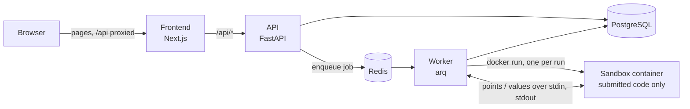
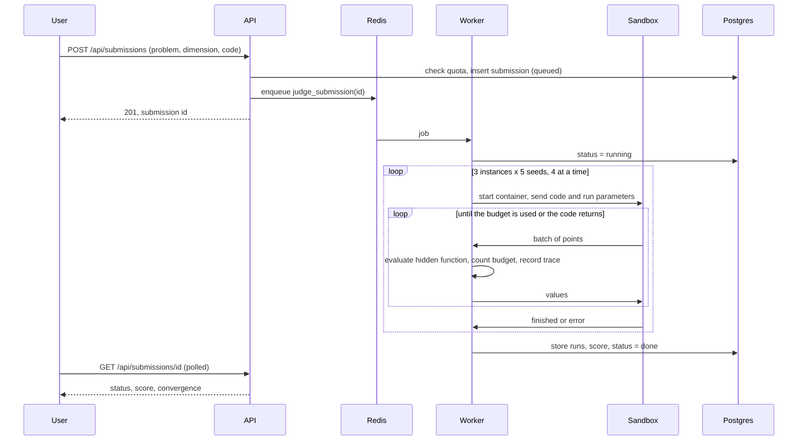
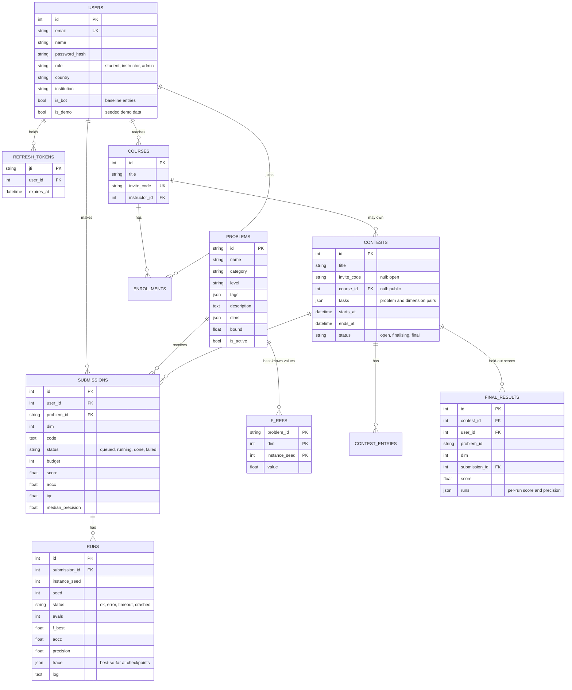

# Architecture

## Components

| Component | Location | Role |
|---|---|---|
| Frontend | `frontend/` | Next.js app. Proxies `/api/*` to the API so auth cookies are first-party. |
| API | `backend/api/` | Accounts, problem catalogue, submissions, leaderboards, statistics, admin. |
| Judge | `backend/judge/` | Hidden functions, instances, runner, scoring. Imported by the worker. |
| Worker | `worker/` | Takes submission ids from the queue, runs the judge, stores results. |
| Sandbox | `sandbox/` | Image and harness that run submitted code with no network and tight limits. |
| Database | PostgreSQL | Users, problems, submissions, runs, reference values. |
| Queue | Redis | Job queue between API and worker. |

The worker needs access to the Docker daemon to start sandbox containers, so the API
and worker must run on a host that can run containers. The frontend has no such need.

## What happens to a submission

If a run finds a value below the best known for its instance, the stored reference
value is lowered and every submission on that problem and dimension is re-scored from
its stored traces in the same transaction.

If the judge itself fails (for example Docker is unavailable) the submission is marked
`failed` with a platform-error message; the user's code is not blamed.

## Data model

The `PROBLEMS` table holds only the public catalogue entry. The functions are code in
`backend/judge/functions.py` and are never stored in the database or sent to a client.

## Accounts and sessions

- Passwords are hashed with Argon2.
- Sign-in sets two httpOnly, SameSite=Lax cookies: a 15-minute access token and a
  7-day refresh token (both JWT). They are also marked Secure outside development.
- A refresh token works once. Using it deletes its database row and issues a new pair,
  so a replayed token is rejected.
- State-changing requests carrying an `Origin` header other than the frontend's are
  refused.

## Contests and courses

- A contest is a set of tasks (problem and dimension) with a start and end time. It is
  open to everyone, protected by an invite code, or attached to a course. Instructors
  and admins create contests; a participant joins, then submits to its tasks from the
  contest page. See `JUDGE.md` for the public and held-out evaluation.
- A course has an instructor and an invite code. Its contests are visible only to its
  members. The instructor's dashboard shows each student's best public score on every
  course contest task, their submission count and their last activity.

## AI features and contributions

- All language-model calls go through `backend/ai/llm.py` (prompts in
  `backend/ai/prompts/`, JSON answers validated by schema, cache, daily limits, a log
  row per call in `llm_calls`). See `AI_FEATURES.md`.
- Analysis and coach notes are stored once per submission in `ai_notes`.
- Contributions (`contributions`) move from `testing` (smoke test queued) to `failed` or
  `pending`, then to `approved` (a `C-NNN` row in `problems`, with its own `lower` and
  `upper`) or `rejected`. Their code runs only in evaluator containers.

## Course tests

- `exams` (a "test" in the interface) belong to a course and go draft -> live ->
  closed. `questions` hold the kind and its data; reasoning questions keep their pool
  of phrasings and whether the instructor approved it.
- Starting a test creates an `attempt` and one `answer` per question with the prompt
  as that student sees it (numeric parameters and run facts filled in). Correct
  numeric answers are recomputed from `hash(test, student, question)` when grading and
  are never stored with the student's view.
- Handing in queues `grade_attempt`; closing a test hands in open attempts. Every grade
  writes a `grade_events` row (automatic grades with no actor).
- `integrity_events` are the browser signals; a daily worker cron job deletes rows
  older than `INTEGRITY_LOG_RETENTION_DAYS`. See `PRIVACY.md`.
- Code similarity (`backend/exams/similarity.py`) compares students' latest judged
  submissions on one problem by normalised token 5-grams and syntax-tree node
  sequences, leaving out pairs explained by a shared starter template.

## Ratings

- Problem leaderboard: each user's best submission on that problem and dimension.
  Baselines appear there, flagged.
- Global rating: the sum, over problems, of a user's best score on that problem.
  Countries and institutions are ranked by the mean rating of their rated members.
  Baselines are excluded.

## API

Interactive documentation is served by the API at `/docs`.

| Area | Endpoints |
|---|---|
| Auth | `POST /api/auth/signup`, `login`, `refresh`, `logout`; `GET /api/auth/me` |
| Users | `GET /api/users/{id}`, `PATCH /api/users/me` |
| Problems | `GET /api/problems`, `/problems/{id}`, `/problems/{id}/leaderboard?dim=`, `/problems/{id}/quota`, `/templates` |
| Submissions | `POST /api/submissions`, `GET /api/submissions`, `GET /api/submissions/{id}` |
| Boards | `GET /api/leaderboard?by=user|country|institution`, `GET /api/stats` |
| Contests | `GET/POST /api/contests`, `GET /api/contests/{id}`, `POST .../join`, `GET .../leaderboard`, `POST .../finalise` |
| Courses | `GET/POST /api/courses`, `POST /api/courses/join`, `GET /api/courses/{id}/dashboard` |
| AI | `GET /api/ai/status`, `GET /api/submissions/{id}/notes`, `POST /api/submissions/{id}/analysis`, `POST /api/submissions/{id}/coach` |
| Tests | `GET/POST /api/tests`, `GET/PATCH /api/tests/{id}`, `GET/POST /api/tests/{id}/questions`, `PUT/DELETE .../questions/{qid}`, `POST .../distractors`, `.../pool`, `.../approve-pool`, `POST /api/tests/{id}/attempt`, `GET /api/attempts/{id}`, `PUT /api/answers/{id}`, `PUT /api/answers/{id}/follow-up`, `POST /api/attempts/{id}/events`, `POST /api/attempts/{id}/submit`, `GET /api/tests/{id}/results`, `POST /api/answers/{id}/grade`, `POST /api/attempts/{id}/viva` |
| Similarity | `GET /api/courses/{id}/similarity?problem_id=&dim=`, `POST /api/courses/{id}/similarity/opinion` |
| Contributions | `GET/POST /api/contributions`, `POST /api/contributions/build`, `GET /api/admin/contributions`, `POST /api/admin/contributions/{id}/approve|reject` |
| Admin | `GET/PATCH /api/admin/users`, `GET/PATCH /api/admin/problems`, `POST /api/admin/problems/{id}/baselines`, `POST /api/admin/problems/{id}/ai-baseline`, `GET /api/admin/submissions` |

A submission's score and convergence are public. Its code, logs and error messages are
returned only to its author and to admins.
